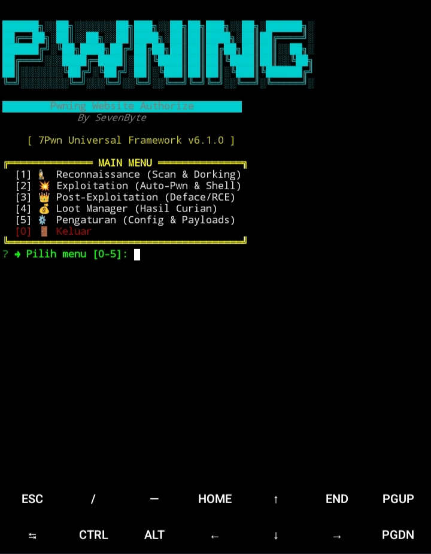

# 7Pwn Universal Framework 🥷

> **Pwning Website Authorize** — Build to Understand.  
> Framework otomatisasi *Penetration Testing* berbasis Node.js yang dirancang khusus untuk berjalan di **Termux (Android)** atau **Linux**. Mensimulasikan siklus serangan (*Recon, Exploit, Post-Exploit*) secara *real-time* dengan antarmuka CLI yang interaktif.


---

## 📸 Tampilan Framework

<p align="center">
  
</p>

<p align="center">
  <i>7Pwn Universal Framework — Interactive CLI Interface</i>
</p>

---

## 🚀 Fitur Utama (Kill Chain)

`7Pwn` membagi proses *Pwning* menjadi 4 fase otomatis:

<details>
<summary><b>1. Reconnaissance (Menu 1)</b></summary>
<br>

- **Mass Dorking:** Mencari target massal via Bing dengan rotasi kata kunci.
- **Auto-Validate:** Langsung mengetes URL yang ditemukan dengan *payload* SQLi/LFI/RCE.
- **GitHub Payload Manager:** Mengunduh ribuan *payload* dari repositori GitHub (mendukung Token untuk menghindari *rate limit*).
- **WAF Detector:** Mendeteksi proteksi (Cloudflare, Imperva) sebelum menyerang.
</details>

<details>
<summary><b>2. Exploitation (Menu 2)</b></summary>
<br>

- **Auto-Exploit SQLi:** Menembak target dengan `sqlmap` secara *real-time*.
- **Auto-Exploit RCE/LFI:** Menembakkan *payload* Command Injection & membaca file server.
- **Auto-Path Analyzer:** Menganalisis *error message* untuk menemukan *Document Root* server (tidak menebak `/var/www/html/`).
</details>

<details>
<summary><b>3. Weaponize / Deploy (Menu 2 -> 3)</b></summary>
<br>

- Menanam *Webshell* via `INTO OUTFILE`. Bisa dari file lokal HP atau *Raw URL* GitHub.
</details>

<details>
<summary><b>4. Post-Exploitation (Menu 3)</b></summary>
<br>

- **Interactive Shell:** Terminal interaktif (RCE) untuk mengeksekusi perintah (`ls`, `whoami`, `cat /etc/passwd`).
- **Defacement:** Mengubah halaman depan target.
</details>

---

## ⚙️ Instalasi di Termux

Pastikan kamu sudah menginstal **Node.js**, **Git**, dan **SQLMap** di Termux. Salin seluruh perintah di bawah ini (klik ikon *Copy* di pojok kanan atas), lalu tempelkan ke Termux:

```
# 1. Update dan Install Dependensi Sistem
pkg update && pkg upgrade -y
pkg install nodejs git sqlmap -y

# 2. Clone Repositori ini
git clone https://github.com/Fly3417/7Pwn.git
cd 7Pwn

# 3. Instal dependensi Node.js
npm install

# 4. Jalankan Framework
node index.js
```

---

## 🛠️ Konfigurasi

Semua pengaturan utama tersimpan di dalam file `config.json`:

| Parameter | Deskripsi |
| :--- | :--- |
| `github_token` | Masukkan Personal Access Token GitHub kamu agar bisa mengunduh *payload* tanpa terkena batas 60 *request*/jam. |
| `tamper_scripts` | Daftar *tamper* SQLMap untuk melewati WAF. |
| `use_proxy` | Set `true` jika ingin menggunakan proxy (atur alamatnya di `proxy_url`). |

---

## 📂 Struktur Project

```text
7Pwn/
├── index.js                # Main Router / Launcher
├── config.json             # Konfigurasi global (Token, Proxy)
├── core/                   # Logika inti
│   ├── engine.js           # HTTP Client & Spawn Command
│   ├── ui.js               # Tampilan Terminal (ASCII Art)
│   ├── utils.js            # Helper (Hash, Logger, Loader)
│   ├── target_profiler.js  # Analisis CMS/Server Target
│   ├── path_analyzer.js    # Auto-detect Document Root
│   └── waf_evasion.js      # Logika Bypass WAF
├── menus/                  # Submenu interaktif
│   ├── recon.js            # Menu Reconnaissance
│   ├── exploit.js          # Menu Exploitation
│   ├── post.js             # Menu Post-Exploitation
│   └── loot_manager.js     # Menu Loot
├── modules/                # Modul eksekusi
│   ├── scraper.js          # Mass Dorking (Bing)
│   ├── scanner.js          # Deteksi SQLi/LFI/RCE
│   ├── smart_recon.js      # Workflow Auto-Scan
│   ├── exploit_sqli.js     # SQLmap Integration
│   ├── exploit_rce.js      # Command Injection
│   ├── exploit_wordpress.js# WPScan Integration
│   ├── shell_deployer.js   # Upload Webshell
│   ├── shell_manager.js    # Interactive Shell
│   └── github_payloads.js  # Download Payload dari GitHub
├── payloads/               # File Webshell & Deface
├── wordlists/              # Daftar Payload (SQLi, LFI, RCE)
├── logs/                   # Log Aktivitas HTTP
├── targets/                # List URL target (list.txt)
├── results/                # Hasil Scan (vulnerable.txt)
└── assets/                 # Gambar untuk README
```

---

## 🚧 Status Pengembangan

> [!NOTE]
> **7Pwn v6.2.0 (Beta)**
> 
> Framework ini masih dalam tahap pengembangan aktif. Saat ini, `7Pwn` sudah mendukung *Smart Recon*, *CMS Profiling* (WordPress/Drupal), dan *Auto-Exploit SQLi*. 
> 
> Jika kamu menemukan *bug*, *error*, atau memiliki saran fitur baru, silakan hubungi kontak di bawah. Kami sangat terbuka untuk *feedback* dari *Security Researcher* lain!

---

## ⚠️ DISCLAIMER (PENTING!)

> [!CAUTION]
> **7Pwn dibuat HANYA untuk tujuan edukasi, penelitian keamanan, dan pengujian pada sistem yang telah mendapatkan izin tertulis (*Authorized Penetration Testing*).**
> 
> - Penulis (**SevenByte**) tidak bertanggung jawab atas penyalahgunaan alat ini.
> - Menggunakan alat ini untuk menyerang target tanpa izin adalah **TINDAKAN PIDANA** (UU ITE di Indonesia, atau hukum siber di negara lain).
> - Selalu gunakan target latihan legal seperti `testphp.vulnweb.com`, lab lokal (DVWA), atau VPS milikmu sendiri.
> - **Jangan pernah** menggunakan fitur Deploy Webshell atau Defacement pada sistem milik orang lain.

---

## 📬 Hubungi Saya (Laporkan Bug / Diskusi)

[](mailto:sevenbyte071@gmail.com)
[](https://t.me/Sevenbyte7)
[](https://github.com/Fly3417)

---
*Pwning Website Authorize - Build to Understand.*
