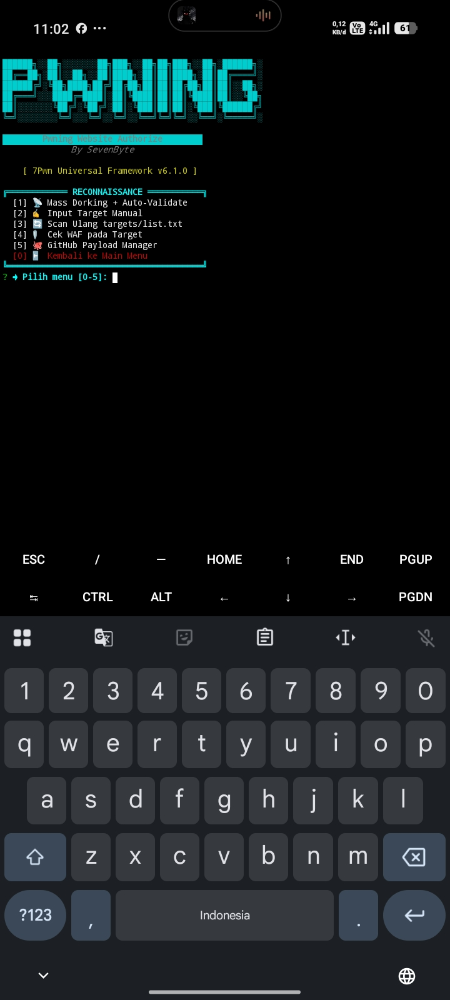
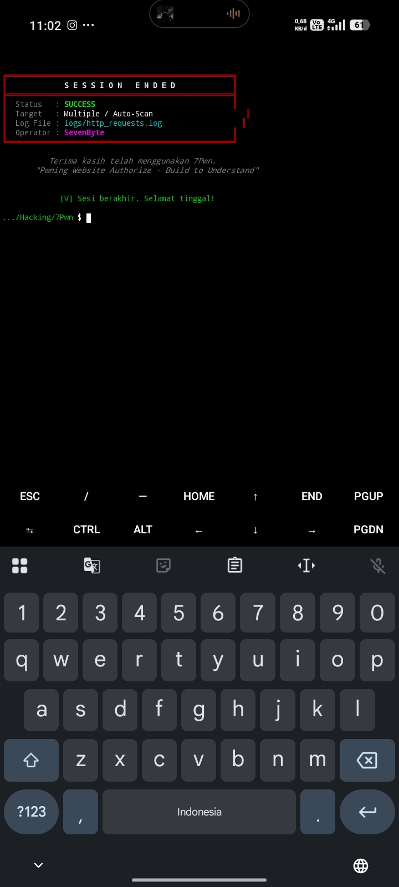

# 7Pwn Universal Framework 🥷

> **Pwning Website Authorize** — Build to Understand.  
> Framework otomatisasi *Penetration Testing* berbasis Node.js yang dirancang khusus untuk berjalan di **Termux (Android)** atau **Linux**. Mensimulasikan siklus serangan (*Recon, Exploit, Post-Exploit*) secara *real-time* dengan antarmuka CLI yang interaktif.

---

## 📸 Tampilan Framework

| Main Menu | Reconnaissance | Session End |
| :---: | :---: | :---: |
|  |  |  |

---

## 🚀 Fitur Utama (Kill Chain)

`7Pwn` membagi proses *Pwning* menjadi 4 fase otomatis:

1. **Reconnaissance (Menu 1):**
   - **Mass Dorking:** Mencari target massal via Bing dengan rotasi kata kunci.
   - **Auto-Validate:** Langsung mengetes URL yang ditemukan dengan *payload* SQLi/LFI/RCE.
   - **GitHub Payload Manager:** Mengunduh ribuan *payload* dari repositori GitHub (mendukung Token untuk menghindari *rate limit*).
   - **WAF Detector:** Mendeteksi proteksi (Cloudflare, Imperva) sebelum menyerang.
2. **Exploitation (Menu 2):**
   - **Auto-Exploit SQLi:** Menembak target dengan `sqlmap` secara *real-time*.
   - **Auto-Exploit RCE/LFI:** Menembakkan *payload* Command Injection & membaca file server.
   - **Auto-Path Analyzer:** Menganalisis *error message* untuk menemukan *Document Root* server (tidak menebak `/var/www/html/`).
3. **Weaponize / Deploy (Menu 2 -> 3):**
   - Menanam *Webshell* via `INTO OUTFILE`. Bisa dari file lokal HP atau *Raw URL* GitHub.
4. **Post-Exploitation (Menu 3):**
   - **Interactive Shell:** Terminal interaktif (RCE) untuk mengeksekusi perintah (`ls`, `whoami`, `cat /etc/passwd`).
   - **Defacement:** Mengubah halaman depan target.

---

## ⚙️ Instalasi di Termux

Pastikan kamu sudah menginstal **Node.js**, **Git**, dan **SQLMap** di Termux.

bash
# 1. Update dan Install Dependensi Sistem
pkg update && pkg upgrade -y
pkg install nodejs git sqlmap -y

# 2. Clone Repositori ini
git clone https://github.com/Fly3417/7Pwn.git
cd 7Pwn

# 3. Instal dependensi Node.js
npm install

# 4. Jalankan Framework
node index.js

---

🛠️ Konfigurasi

Semua pengaturan tersimpan di config.json:

· github_token: Masukkan Personal Access Token GitHub kamu agar bisa mengunduh payload tanpa terkena batas 60 request/jam.
· tamper_scripts: Daftar tamper SQLMap untuk melewati WAF.
· use_proxy: Set true jika ingin menggunakan proxy (atur di proxy_url).

---

📂 Struktur Project

text
7Pwn/
├── index.js            # Main Router (Launcher)
├── config.json         # Konfigurasi Global
├── core/               # Logika Inti (Engine, UI, Path Analyzer)
├── menus/              # Submenu Interaktif (Recon, Exploit, Post, Loot)
├── modules/            # Modul Eksekusi (SQLi, RCE, Shell Manager)
├── payloads/           # File Webshell & Deface
├── wordlists/          # Daftar Payload (SQLi, LFI, RCE)
├── logs/               # Log aktivitas HTTP & Error
├── targets/            # Daftar URL target yang rentan
├── loot/               # Tempat penyimpanan hasil dump database
└── assets/             # Gambar untuk README

---

🚧 Status Pengembangan

7Pwn masih dalam tahap pengembangan aktif (Beta).
Jika kamu menemukan bug, error, atau ingin memberikan saran fitur baru, silakan hubungi kontak di bawah ini. Kami sangat terbuka untuk feedback dari Security Researcher lain!

---

⚠️ DISCLAIMER (PENTING!)

7Pwn dibuat HANYA untuk tujuan edukasi, penelitian keamanan, dan pengujian pada sistem yang telah mendapatkan izin tertulis (Authorized Penetration Testing).

· Penulis (SevenByte) tidak bertanggung jawab atas penyalahgunaan alat ini.
· Menggunakan alat ini untuk menyerang target tanpa izin adalah TINDAKAN PIDANA (UU ITE di Indonesia, atau hukum siber di negara lain).
· Selalu gunakan target latihan legal seperti testphp.vulnweb.com, lab lokal (DVWA), atau VPS milikmu sendiri.
· Jangan pernah menggunakan fitur Deploy Webshell atau Defacement pada sistem milik orang lain.

---

📬 Hubungi Saya (Laporkan Bug / Diskusi)

https://img.shields.io/badge/Email-akumuyui24%40gmail.com-red?style=for-the-badge&logo=gmail&logoColor=white
https://img.shields.io/badge/Telegram-%40Sevenbyte7-blue?style=for-the-badge&logo=telegram&logoColor=white
https://img.shields.io/badge/GitHub-Fly3417-black?style=for-the-badge&logo=github&logoColor=white

---

Pwning Website Authorize - Build to Understand.

